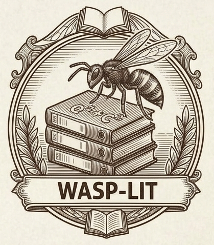

<p align="center"></p>

# wasp-lit

When a GWAS or genetic study nominates a candidate gene, `wasp-lit` evaluates whether that gene is a plausible causal contributor to the phenotype. It searches both the candidate gene and the phenotype against a shared keyword ontology, identifies overlapping biological mechanisms across both literature arms, and synthesizes direct and convergent evidence while pinpointing empirical gaps and testable experiments.

Part of a four-skill research suite with [`beaver-data`](https://github.com/chen42/beaver-data) (reproducible data analysis), [`weaver-text`](https://github.com/chen42/weaver-text) (manuscript and grant editing), and [`honeybee-lit`](https://github.com/chen42/honeybee-lit) (general literature reviews).

**Version `0.4.0`.** Adapted from [GeneCup](https://github.com/hakangunturkun/GeneCup).

## Why a wasp?

A paper wasp builds its nest one cell at a time and returns to extend the same structure. `wasp-lit` builds its corpus the same way: one record per PMID, added in durable layers that later runs reuse rather than rebuild.

## What it does

1. **Stage 1: Baseline Gene & GWAS Context**: Collect NCBI Gene and WikiGenes function profiles for each candidate gene (`gene-function.md`), retrieve curated NHGRI-EBI GWAS Catalog associations (`phenotype-search`, `associations`, `gwas-associations.md`), and select priority ontology concepts.
2. **Stage 2: Dual-Arm Search Plan**: Freeze the approved scope and query plan (`init`, `plan-search`) covering both the **Gene Arm** and the **Phenotype Mechanism Arm** against the shared keyword ontology in the same workspace.
3. **Stage 3: PubMed Enumeration & Collection**: Enumerate all matching PMIDs and fetch capped abstracts (`collect`) using identical preferential sampling rules across both arms (`200` abstracts for priority ontology concepts and `30` for remaining concepts).
4. **Stage 4: Triage, Screening & Full-Text Retrieval**: Screen retrieved abstracts with Jev structured classification (`triage`, `triage-report`) and bounded `concept-screener` subagent jobs (`jobs`, `record-assessments`), and fetch accessible PMC full texts (`fulltext`).
5. **Stage 5: Concept Reviews & Dual-Hub Bipartite Knowledge Graph**: Generate per-concept syntheses (`okf/concepts/<slug>.md`) first (**Stage 5a**), then construct the interactive Dual-Hub Bipartite Knowledge Graph (`okf`, `okf.html`, `okf/index.md`) mapping `Gene ──► Shared Ontology Concepts ◄── Phenotype` (**Stage 5b**).
6. **Stage 6: Final Plausibility Synthesis & HTML Portal**: Write the journal-style synthesis (`synthesis.md`) **after** the knowledge graph, starting with a citation-free summary of direct and circumstantial evidence, followed by the bipartite overlap table, detailed findings (200-300 words per mechanism with PubMed abstract hover popups), methodological limitations, and falsifiable experimental tests. Render the complete interactive HTML portal and shareable ZIP (`render-html --zip`).
7. **Reopen & Extend**: Reopen the saved corpus in later conversations (`packet`, `status`) or extend with new run IDs without rebuilding prior layers.

Genes are never ranked by publication counts, and no numerical causal scores are produced.

## Reproducibility and standardization

- **Frozen scope.** Approved context, ontology, and exact queries are frozen per workspace. A vocabulary change requires a new workspace.
- **Fixed dual-arm sampling rules.** Both the candidate gene arm (`Gene × Ontology Concept`) and the phenotype mechanism arm (`Phenotype × Ontology Concept`), plus a direct `Gene × Phenotype` query, are searched in the same workspace using identical preferential caps: `200` abstracts for priority concepts and `30` for all others, applied to the newest records after full PMID enumeration.
- **Complete provenance.** Raw XML responses, query translations, all discovered PMIDs, timestamps, and checksums are saved before screening. Source responses are immutable.
- **Resumable runs.** Repeating a run ID resumes it; `--refresh` with a new run ID updates sources while keeping earlier responses.
- **Standard screening packets.** Each worker gets one subject arm × one concept, a fixed screener rubric, and read-only tools. Outputs are validated for PMIDs, counts, enums, record hashes, and quotation fidelity before import.
- **Hash-locked evidence.** Each assessment stores the record hash it was screened against, so old evidence resolves to the exact abstract it used.
- **Separate GWAS lane.** Curated GWAS Catalog associations are recorded for every eligible human gene, separate from PubMed screening, and integrated as a toggleable node in the knowledge graph.
- **Distinct failure states.** Missing abstracts, failed requests, and empty searches are recorded as different states. A failed search is never reported as zero evidence.

## Package contents

```text
wasp-lit/
├── SKILL.md                # Agent instructions and 6-stage pipeline specification
├── README.md
├── LICENSE
├── assets/wasp-lib.jpg
├── agents/                 # concept-screener subagent definition
├── references/             # Workflow, search, screening, full-text, corpus, and runbook guides
├── resources/              # Curated addiction keyword ontology (current and legacy)
├── scripts/                # wasp.py CLI, core library, PubMed, WikiGenes, GWAS Catalog, Jev triage, OKF export, and HTML renderer
├── templates/              # Context example, search record, concept domains, synthesis
├── synthesis_prompt.txt    # Stage 6 journal-style candidate-gene synthesis prompt
├── jev.md                  # Jev structured abstract triage documentation
├── addiction_ontology.json # Original GeneCup ontology (unchanged; checked by tests)
├── plan/                   # Ontology curation record
└── tests/                  # Unit tests and fixtures
```

## Project workspace

Create one top-level folder per search named `wasp-lit-<gene>-<phenotype>/` (or `wasp-lit-<genes>-<phenotype>/`). Human-facing deliverables live at the top level as portable Markdown files and rendered HTML pages (with universal PubMed abstract hover popups), while all machine JSON/JSONL tables and immutable source responses live inside `corpus/` (existing legacy workspaces under `references/wasp/` remain supported):

```text
wasp-lit-<gene>-<phenotype>/
├── README.md / .html          # Run status, pipeline stages, corpus counts, and guide to deliverables
├── synthesis.md / .html       # Stage 6 narrative synthesis (Summary, Bipartite Overlap, Detailed findings, Limitations, Sources)
├── okf.html                   # Full-width interactive Dual-Hub Bipartite Knowledge Graph (Cytoscape.js) and side-panel reader
├── gene-function.md / .html   # Baseline gene/protein biology (or gene-function/<GENE>.md for multi-gene runs)
├── gwas-associations.md /.html# Human-readable GWAS Catalog summary table
├── ontology.md / .html        # Search ontology hierarchy, keyword expansions, and per-concept hit statistics
├── user-decisions.md / .html  # Human-approved scope, preferential concept caps, and manual overrides (synced with human-decisions.md)
├── ai-decisions.md / .html    # AI concept-cap rationale, Jev triage summary, and subagent screening ledger
├── pmid-cache.js              # Pre-cached PubMed metadata and abstracts for instant hover tooltips across all HTML pages
├── <workspace>-shareable.zip  # Self-contained shareable ZIP archive of all HTML pages and web assets (excluding .md files)
├── okf/                       # Two-tier Open Knowledge Format network (Stage 5a Concept Reviews & Stage 5b Graph)
│   ├── index.md / .html       # Top-level ontology and emerging topics catalog
│   ├── concepts/<SLUG>.md/.html # Focused Concept Reviews and Emerging Topic Reviews (type: Concept)
│   └── <PMID>.md / .html      # Atomic Reference Notes for confirmed included studies (type: Reference)
└── corpus/                    # Machine state and immutable source cache
    ├── manifest.json, context.json, approved-context.json, ontology.json, queries.json
    ├── overview.json, audit.json, okf_graph.json, emerging_topics.json, jobs-index.json
    ├── articles.jsonl, membership.jsonl, evidence.jsonl, triage.jsonl, fulltexts.jsonl
    ├── human_decisions.jsonl, associations.jsonl, association_evidence.jsonl, sources.jsonl
    ├── gene-function/         # Raw JSON extracts from NCBI Gene and WikiGenes
    ├── association-runs/      # Raw GWAS Catalog query captures and trait reports
    ├── runs/, triage-runs/, jobs/, waves/, assessments/
    └── sources/               # Immutable PubMed XML batches, esearch JSONs, and PMC full-text captures
```

See [corpus and resume](references/corpus-and-resume.md).

## Companion skills

| Skill | Role |
|---|---|
| [`beaver-data`](https://github.com/chen42/beaver-data) | Approved statistical analysis, including quantitative evidence synthesis. |
| [`weaver-text`](https://github.com/chen42/weaver-text) | AI editing, review, and submission help for author-written manuscripts and grant proposals. |
| [`honeybee-lit`](https://github.com/chen42/honeybee-lit) | General literature reviews, from citation checks to narrative, scoping, and systematic reviews. |
| [`wasp-lit`](https://github.com/chen42/wasp-lit) | Post-GWAS literature analysis of candidate gene-phenotype relationships. |

Synthesis follows [`weaver-text`](https://github.com/chen42/weaver-text) citation and source-capture guidance.

## Installation

Clone the repository, unchanged, into a skills directory your agent harness scans:

```bash
# Shared cross-harness skills directory (Antigravity, Codex, OpenCode)
git clone https://github.com/chen42/wasp-lit.git ~/.agents/skills/wasp-lit

# Pi
git clone https://github.com/chen42/wasp-lit.git ~/.pi/agent/skills/wasp-lit

# Claude Code
git clone https://github.com/chen42/wasp-lit.git ~/.claude/skills/wasp-lit
```

In Pi, run `/reload` after cloning, or list the path under `"skills"` in `~/.pi/agent/settings.json`.

Requirements: Live retrieval requires the installed [`pubmed-database`](../pubmed_database/SKILL.md) skill, [`credentials`](../credentials/SKILL.md) (NCBI API key), and [`uv`](../uv/SKILL.md); screening uses `pi-subagents` in Pi or the host harness's native subagent tool (`jobs-index.json` and `evidence-record`). Optional Jev triage (`wasp.py triage`) runs directly in Python over HTTP or from saved captures. Offline commands need only the Python standard library.

Verify the installation from the skill directory:

```bash
cd ~/.agents/skills/wasp-lit  # or your install path
python3 scripts/wasp.py doctor
python3 -m unittest discover -s tests -v
```

Full commands are in the [runbook](references/runbook.md).

## License

[MIT](LICENSE)
